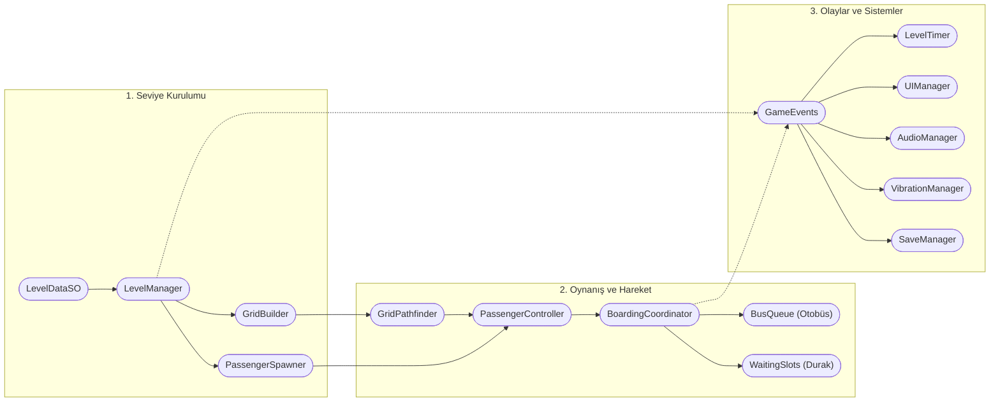
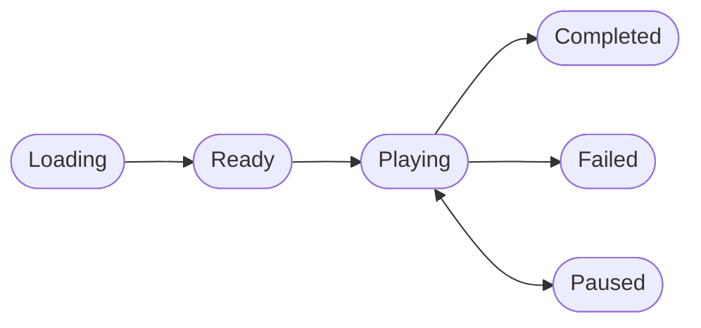

# Oyun Mimarisi

Bu belge, Bus Jam Clone'un mevcut kodunda bir seviyenin nasıl yüklendiğini ve bir yolcunun seçilmesinden otobüsün kalkmasına kadar hangi bileşenlerin çalıştığını anlatır. Kaynak kodu değiştirecek geliştiriciler için hazırlanmıştır. Projede tek etkin sahne `Assets/Scenes/Game.unity` ve Unity sürümü **2022.3.19f1**'dir.

## Genel yapı

Bu şema veri ve çağrı ilişkilerini özetler; `GameEvents` başka bileşenler arasında da mesaj taşır. Bileşen referanslarının önemli bir bölümü `Game.unity` sahnesinde serileştirilmiştir.

| Bölüm | Sorumluluk |
| --- | --- |
| `Core` | Renkler, kapasite ve sınırlar, statik oyun olayları, prefab havuzu. |
| `Level` ve `Resources/Levels` | Seviye verisi, seviye durumu, yükleme ve zamanlayıcı. |
| `Gameplay/Grid` | Etkin hücreleri oluşturma ve çıkışa erişimi hesaplama. |
| `Gameplay/Passenger` | Yolcu durumu, hareketi, özel tür mekaniği, seçimi ve biniş koordinasyonu. |
| `Gameplay/Bus` ve `WaitingSlots` | Aktif otobüs, koltuklar, kuyruk geçişi ve bekleme yerleri. |
| `Systems` | UI, ses, titreşim ve kamera. |
| `Save` | Mevcut seviyeyi ve tercihleri JSON olarak saklama. |
| `Editor` | `LevelDataSO` assetlerini düzenleyen Unity Editor araçları; oyun derlemesindeki oynanış akışının parçası değildir. |

## Seviye verisi ve yükleme sırası

Her `LevelDataSO` asseti `LevelNumber`, `TimeLimit`, `GridSize` ile hücre, otobüs ve yolcu listelerini tutar. `PassengerData` içinde renk, koordinat, isteğe bağlı `PassengerTypeSO` ve türe özel parametre bulunur.

`LevelManager.Start()` açılışta `Resources.LoadAll<LevelDataSO>("Levels")` çağırır, assetleri `LevelNumber` değerine göre sıralar ve kayıt dosyasında bulunan numarayı arar. Geçerli kayıt yoksa sıralı dizinin ilk seviyesinden başlar. Bir seviyeyi yüklerken sırasıyla:

1. Durumu `Loading` yapar ve önceki otobüsleri, bekleme yerlerini, yolcuları ve hücreleri temizler.
2. `GridBuilder.Build`, `PassengerSpawner.Spawn` ve `BusQueue.Build` ile yeni nesneleri oluşturur.
3. Seviye numarasını ve `LevelLoaded` olayını yayınlar. `PassengerController` bu olayda yolcuları izlemeye başlar; `LevelTimer` süreyi hazırlar.
4. Durumu `Ready` yapar ve mevcut seviye numarası ile ses/titreşim tercihlerini kaydeder.

`LevelLoaded` yayınlandığında yöneticinin durumu hâlâ `Loading`'dir; hemen ardından `Ready` olayı gelir.

## Izgara, erişim ve yolcu seçimi

`GridBuilder`, yalnız `GridCells` listesindeki hücreleri oluşturur. Koordinatı **`y = 0`** olan etkin hücreleri çıkış olarak işaretler. `GridPathfinder`, çıkışlardan başlayarak boş hücreler üzerinden erişimi hesaplar; dolu hücreler başka bir yolcunun içinden geçilecek koridor sayılmaz. Yolcu hareket ettiğinde erişim bilgisi yeniden hesaplanır.

`Passenger.OnMouseDown()` seçilebilir yolcunun tıklanmasını `PassengerController`'a bildirir. Girdi yalnız seviye `Playing` durumundayken işlenir. Yolcunun ızgarada olması, çıkışa erişebilmesi ve varsa tür mekaniğinin harekete izin vermesi gerekir. Kontrolcü uygun rotayı `GridPathfinder` ile alır.

`PassengerController` şu kararı verir:

- Aktif otobüsün rengi eşleşiyor ve yeterli koltuk varsa yolcu otobüse yönlendirilir.
- Bu koşul sağlanmıyorsa boş bir bekleme yeri ayrılabiliyorsa yolcu oraya yönlendirilir.
- İki hedef de uygun değilse seçim bir hareket başlatmaz.

`BoardingCoordinator`, başlayan yolculukları takip eder. Yolcu ızgaradan ayrılırken hücresi boşaltılır; güzergâh çıkıştan yürüyüş alanına, oradan otobüsün biniş noktasına veya bekleme yerine uzatılır. Hareket animasyonlarını `PassengerMovement` ve DOTween yürütür. Otobüse yaklaşan yolcu için koltuk ayrımı varışta tamamlanır; devam eden yolculukların koltuk talebi de yeni seçimlerde hesaba katılır.

## Otobüs sırası, bekleme alanı ve sonuç

`BusQueue` yalnız sıranın önündeki otobüsü aktif tutar. Bir otobüsün kapasitesi `GameConstants.BusCapacity = 3` koltuktur; bir `PassengerTypeSO` birden fazla koltuk isteyebilir. Otobüs dolunca DOTween ile kalkış ve sıradaki otobüsün gelişi oynatılır. Geçiş sırasında biniş kapalıdır. Yeni aktif otobüs bildirildiğinde `BoardingCoordinator`, bekleme yerindeki uygun renkteki yolcuları otomatik olarak yönlendirmeyi dener.

`PassengerController`, hareketler ve otobüs geçişleri tamamlandıktan sonra sonucu kontrol eder:

- **Tamamlanma:** Binmemiş yolcu kalmaz, otobüs kuyruğu boşalır ve bekleme alanı boş olur.
- **Başarısızlık:** Bütün bekleme yerleri `Waiting` durumundaki yolcularla dolarsa veya `LevelTimer` sıfıra inerse. Hareketin beklenmedik şekilde kesilmesi ve geçersiz hedef gibi çalışma hataları da başarısızlık olayı üretebilir.

Sahne beş bekleme yeri tanımlar. Sonraki seviye yalnız `Completed` durumundan ve sıralı listede gerçekten bir sonraki asset varsa yüklenir.

## Durumlar ve olaylar

| Durum | Tetikleyici / Açıklama | Geçiş |
| :--- | :--- | :--- |
| `Loading` | Seviye verisi, hücreler, otobüsler ve yolcular kurulur. | `Ready` |
| `Ready` | Seviye hazır; oyuncunun dokunması beklenir. | `Playing` |
| `Playing` | Zamanlayıcı ve girdi aktiftir; yolcu ve otobüs hareketi sürer. | `Paused`, `Completed`, `Failed` |
| `Paused` | Zamanlayıcı ve animasyonlar dondurulur. | `Playing` |
| `Completed` | Tüm yolcular bindi, otobüs kuyruğu ve duraklar boşaldı. | Sonraki Seviye |
| `Failed` | Bekleme yerleri tamamen doldu veya süre sıfırlandı. | Yeniden Başlat |

`LevelState` değerleri `None`, `Loading`, `Ready`, `Playing`, `Paused`, `Completed` ve `Failed`'dir. Normal akış `Loading → Ready → Playing → Completed/Failed` biçimindedir. `Playing` durumundan `Paused` durumuna, oradan tekrar `Playing` durumuna geçilebilir. Yeniden başlatma mevcut seviyeyi baştan yükler.

`LevelTimer` yalnız `Playing` sırasında azalır. `PassengerController` aynı durumda girdiyi açar; duraklatma yolcu ve otobüs animasyonlarını da durdurur. Bu akış `Time.timeScale` değerini değiştirmez; ilgili sistemler kendi çalışma durumlarını yönetir. `UIManager` başlatma düğmesini ve duraklatma/kazanma/kaybetme panellerini durum olaylarına göre gösterir. Sahnedeki UI düğmeleri `GameEvents` üzerinden başlatma veya devam, duraklatma, yeniden başlatma, sonraki seviye, ses ve titreşim istekleri yollar.

`GameEvents` statik C# olaylarını bir arada tutar. `LevelManager` durum ve seviye yaşam döngüsünü yönetir; diğer sistemler çoğunlukla `OnEnable` sırasında abone olup `OnDisable` sırasında abonelikten çıkar. Örneğin `PassengerMoveStarted` ses ve titreşimi tetikler; `ActiveBusChanged` bekleyen yolcuların yeniden değerlendirilmesini sağlar. Yeni bir olay eklerken yayınlayan ve dinleyen bileşenlerin sırasını gözden geçirin.

## Özel yolcu türleri

`PassengerTypeSO`, editörde görünen ad/etiket, koltuk gereksinimi, ölçek, isteğe bağlı prefab/aksesuar ve parametreyi tanımlar. `Passenger` bu assetten bir `PassengerMechanic` oluşturup ilgili yaşam döngüsü kancalarını çağırabilir. Tür verilmemiş yolcu normal davranır.

Mevcut tür assetleri `Mystery` ve `Frozen`'dır. `Mystery`, çıkışa erişilebilir olduğunda gerçek rengini gösterir. `Frozen`, başka yolcular ızgaradan ayrıldıkça sayacı azalana kadar hareket edemez. Kodda iki koltuk isteyen bir VIP başlangıç asseti oluşturma yolu bulunsa da mevcut projede VIP asseti yoktur; bu türü mevcut içerik olarak varsaymayın. Yeni tür ekleme adımları [`EXTENDING.md`](EXTENDING.md) belgesinde anlatılmıştır.

## Kayıt, görsel ve yardımcı sistemler

`SaveManager`, `Application.persistentDataPath/save.json` dosyasına `LevelNumber`, `IsSoundEnabled` ve `IsVibrationEnabled` alanlarını yazar. Kayıt seviye yüklemenin sonunda, seviye tamamlandığında, uygulama duraklatıldığında ve çıkarken yapılır. Kalan süre, yolcu konumları ve kısmi ilerleme saklanmaz; geri dönüşte seviye yeniden kurulur.

`AudioManager` ve `VibrationManager`, oyun olaylarına ve kullanıcı tercihlerine tepki verir. Ses için sahnede atanmış klipler, titreşim için projeye eklenmiş MOST HapticFeedback kullanılır. `CameraController`, seviye `Ready` olduğunda ızgara, bekleme yerleri ve aktif otobüsü çerçeveler; en-boy oranı değişirse çerçeveyi günceller. `GridBuilder`, `PassengerSpawner` ve `BusQueue`, sık oluşturulan nesneleri `PrefabPool<T>` üzerinden yeniden kullanır.

## Değişiklik yaparken korunacak varsayımlar

- `LevelNumber` değerlerini benzersiz tutun. Sıralama ve kayıt bu sayıya dayanır; editör benzersizliği zorlamaz.
- Yolcu koordinatlarını mevcut etkin hücrelerle eşleştirin. `PassengerSpawner`, yolcunun hücresini doğrudan arar.
- Sahnedeki prefab, biniş noktası, koltuk ve bileşen referanslarını koruyun. `Bus` yapılandırılmış üç koltuk bekler.
- Koltuk sayısı dengesi, yol erişimi, otobüs sırası ve süreyi ayrı ayrı deneyin. Editörün denge göstergesi yalnız renk başına koltuk talebini karşılaştırır.
- Olay aboneliklerini ve havuza dönen nesnelerin durum sıfırlamasını yeni mekaniklerde kontrol edin.