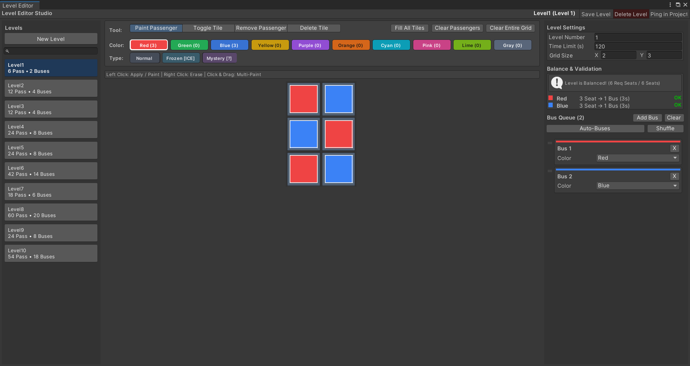

# Seviye Editörü Rehberi

Bu rehber, Bus Jam Clone içindeki özel Unity seviye editörüyle seviye oluşturmayı ve mevcut seviyeleri düzenlemeyi anlatır. Editör verileri `LevelDataSO` assetleri olarak `Assets/Resources/Levels` klasöründe saklar.

## Editörü açma

1. Projeyi Unity **2022.3.19f1** ile açın.
2. Menüden **Tools > Bus Jam > Level Editor** veya **Window > Bus Jam > Level Editor** seçin.
3. Mevcut bir `LevelDataSO` assetini seçtiyseniz Inspector'daki **Open in Level Editor Window** düğmesini de kullanabilirsiniz.

Pencerenin solunda seviye listesi ve arama, ortasında araçlar ile ızgara, sağında seviye ayarları, denge bilgisi ve otobüs sırası bulunur.

## Yeni bir seviye oluşturma

Sol panelde **New Level** düğmesine basın. Editör, mevcut en büyük seviye numarasının bir sonrasını kullanarak `Assets/Resources/Levels/LevelN.asset` oluşturur. Yeni seviye **5 × 5**, **60 saniye**, boş hücre listesi, boş yolcu listesi ve boş otobüs sırasıyla başlar.

Sağ panelde **Level Number**, **Time Limit (s)** ve **Grid Size** alanlarını ayarlayın:

| Alan | Editör sınırı | Tasarım notu |
| --- | --- | --- |
| Level Number | En az 1 | Numara benzersizliğini editör denetlemez. Oyun seviyeleri bu numaraya göre sıralar ve kayıt dosyası mevcut seviyeyi bu numarayla bulur. |
| Time Limit (s) | En az 1 saniye | Süre yalnız oyun `Playing` durumundayken azalır. |
| Grid Size X/Y | Her eksen 1–10 | Izgarayı küçültmek, yeni sınırın dışında kalan hücreleri ve yolcuları siler. |

## Izgarayı ve yolcuları düzenleme

Önce ortadaki **Color** paletinden bir renk seçin. `Paint Passenger` aracıyla bir hücreye sol tıklamak hücreyi etkinleştirir ve o renkte yolcu oluşturur. Mevcut yolcunun üstüne boyarsanız rengi değişir. Sol tuş basılıyken sürükleyerek birden fazla hücreyi düzenleyebilirsiniz.

| Araç | Sol tıklama veya sürükleme sonucu |
| --- | --- |
| `Paint Passenger` | Seçili renkte yolcu oluşturur veya mevcut yolcunun rengini değiştirir. Tür boyama modunda mevcut yolcunun türünü değiştirir. |
| `Toggle Tile` | Hücreyi açar veya kapatır. Kapatılan hücredeki yolcu da silinir. |
| `Remove Passenger` | Yalnızca yolcuyu siler; hücre kalır. |
| `Delete Tile` | Hücreyi ve üzerindeki yolcuyu siler. |

Sağ tıklama hızlı silmedir: hücrede yolcu varsa önce onu siler; yolcu yoksa hücreyi siler. Sağ tuşla sürükleme de uygulanabilir.

Izgaranın üstündeki toplu işlemler:

- **Fill All Tiles:** Izgaradaki tüm hücreleri etkinleştirir; yolcu eklemez.
- **Clear Passengers:** Bütün yolcuları siler; hücreleri korur.
- **Clear Entire Grid:** Hem hücreleri hem yolcuları siler; işlemden önce onay ister.

### Yolcu türleri

**Type** satırındaki `Normal`, `Mystery` veya `Frozen` gibi bir seçenek, `Paint Passenger` aracını tür boyama moduna geçirir. **Tür boyama yalnız mevcut yolcuya uygulanır; boş hücreye yolcu eklemez.** Önce Color paletiyle yolcuyu yerleştirin, sonra türü seçip aynı hücreye tıklayın. `Normal` seçimi özel türü kaldırır.

Bir tür özel parametre kullanıyorsa Type satırında parametre alanı görünür. `Frozen` türünün **Freeze Moves** değeri, başka yolcular ızgaradan ayrıldıkça azalır. `Mystery` yolcu, çıkışa erişilebilir hale gelince gerçek rengini gösterir. Mevcut projede hazır tür assetleri bunlardır; yeni tür ekleme süreci ayrı genişletme rehberinde ele alınacaktır.

## Otobüs sırasını oluşturma

Sağ paneldeki **Bus Queue** alanı otobüslerin geliş sırasını gösterir. Her otobüsün kapasitesi **üç koltuktur**. `Add Bus` ile otobüs ekleyebilir, kartındaki **Color** alanını değiştirebilir, kartları sürükleyerek yeniden sıralayabilir veya `X` ile tek otobüsü silebilirsiniz. **Clear** tüm otobüsleri onay alarak siler; **Shuffle** mevcut sırayı karıştırır.

**Auto-Buses**, mevcut otobüs sırasını silip renk başına koltuk talebini karşılayacak sayıda otobüs oluşturur. Her renk için talebi üçe bölüp yukarı yuvarlar. Örneğin dört koltukluk talep için iki otobüs üretir; bu durumda iki koltuk boş kalır. Otobüs yalnız tamamen dolunca kalktığı ve seviye otobüs kuyruğu boşalmadan tamamlanmadığı için renk başına koltuk talebi toplam otobüs kapasitesine **tam eşit** olmalıdır. Otomatik işlemden sonra otobüs renklerini ve sırasını yeniden kontrol edin.

## Dengeyi ve oynanabilirliği kontrol etme

**Balance & Validation** bölümü, her renk için yolcuların istediği koltuk sayısını aynı renkteki otobüslerin toplam üçer koltuğuyla karşılaştırır. `Level is Balanced!` mesajı bu sayıların eşit olduğunu gösterir. `Seat Mismatch!` mesajında renk satırlarını inceleyin.

Bu gösterge yalnız **koltuk sayısını** denetler. Bir yolcunun çıkışa erişip erişemediğini, otobüs sırasının uygunluğunu veya seviyenin süre içinde bitirilip bitirilemeyeceğini doğrulamaz. Kaydetmeden önce şunları ayrıca kontrol edin:

- En az bir etkin hücre **`y = 0`** satırında olsun; oyun çıkış hücrelerini bu satırdan belirler.
- Yolcuların etkin hücreler üzerinden çıkışa yol bulabileceğinden emin olun. Diğer yolcular yolu kapatabilir.
- Her renk için koltuk talebini ve otobüs kapasitesini karşılaştırın. Özel türlerin koltuk ihtiyacı birden fazla olabilir.
- Otobüs sırasını ve beş bekleme yerinin dolma riskini oynayarak değerlendirin.
- Süreyi gerçekten oynanabilecek bir değerde tutun ve `Level Number` değerinin diğer seviyelerle çakışmadığını kontrol edin.

Basit bir deneme düzeni için yeni 5 × 5 seviyede **Fill All Tiles** kullanın; `(0,1)`, `(1,1)` ve `(2,1)` hücrelerine üç kırmızı normal yolcu koyup sıraya bir kırmızı otobüs ekleyin. Böylece renk başına koltuk talebi üç, kapasite üç olur. Denge mesajından sonra seviyeyi oynayarak yol erişimini ve süreyi ayrıca doğrulayın.

## Kaydetme, deneme ve silme

Üst çubuktaki **Save Level**, seçili seviye assetini kaydeder. Seviye listesindeki `*` işareti kaydedilmemiş değişiklikleri gösterir. **Ping in Project** asseti Project penceresinde seçer. **Delete Level**, onaydan sonra asseti projeden siler.

Oyunu denemek için `Assets/Scenes/Game.unity` sahnesini açıp Play'e basın. **Editörde seçili seviyeyi doğrudan başlatma düğmesi yoktur.** Oyun kayıtlı seviye numarası varsa o seviyeyi, yoksa numaraya göre ilk seviyeyi yükler; yeni seviyeye normal seviye ilerlemesiyle ulaşılır. Editördeki önizlemeyi gerçek oynanış testi yerine kullanmayın.