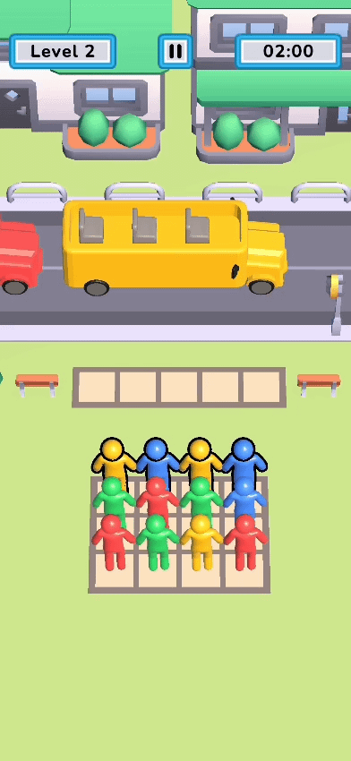
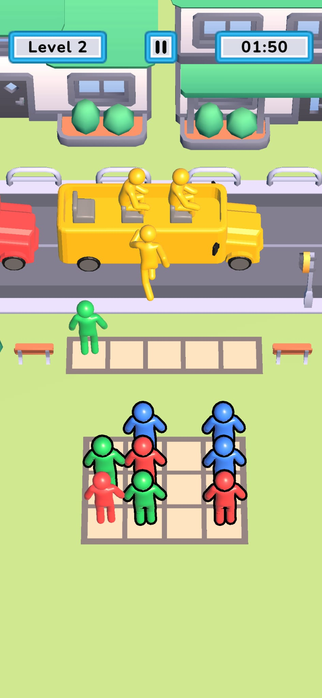
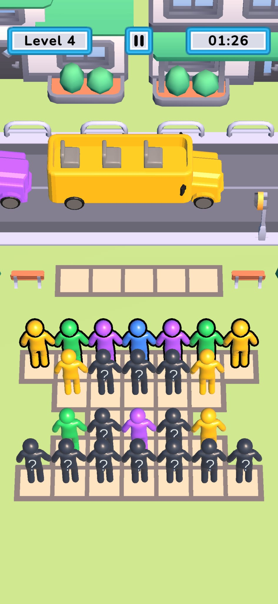
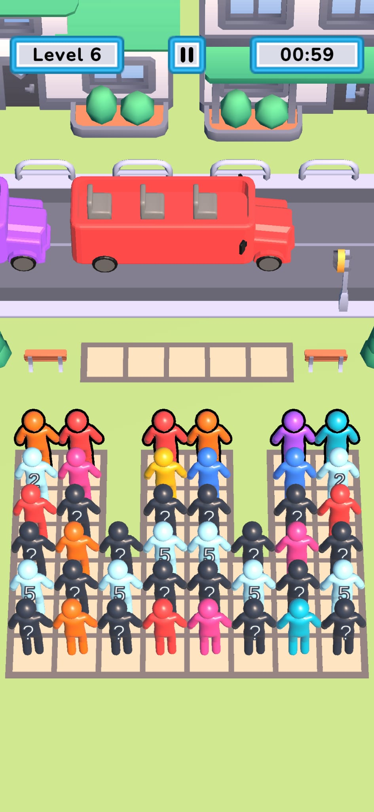
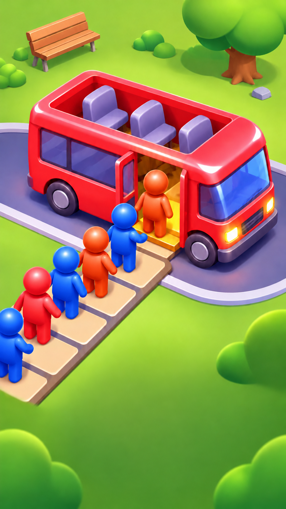
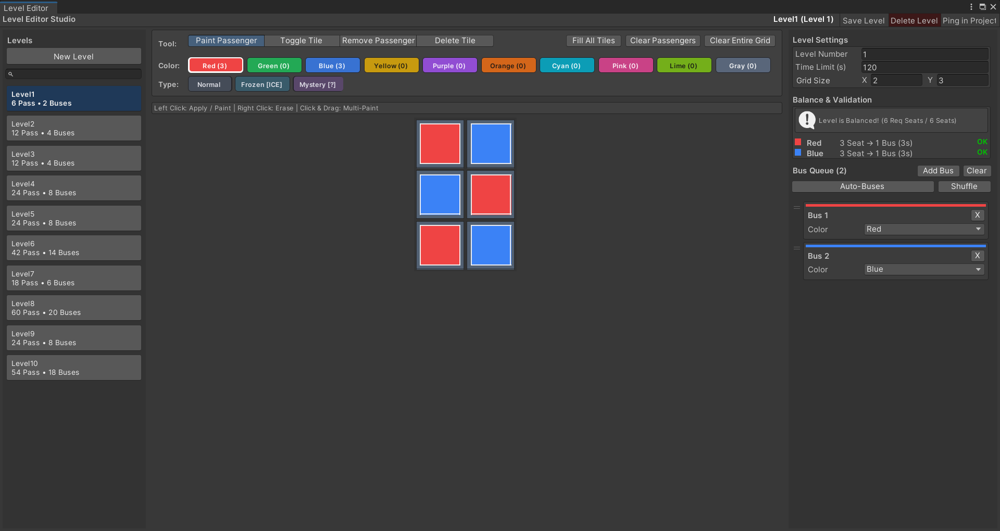

# Bus Jam Clone

Bus Jam Clone, yolcuları renklerine uygun otobüslere yerleştirmeye dayanan bir Unity bulmaca oyunudur. Yolcuların çıkış yolunu açın, otobüs sırasını ve sınırlı bekleme alanını hesaba katın, süre dolmadan bütün otobüsleri gönderin.

---

## Genel Oynanış Görüntüleri

| Canlı Oynanış | Oynanış 1 | Oynanış 2 | Oynanış 3 | Oynanış Videosu |
| :---: | :---: | :---: | :---: | :---: |
|  |  |  |  |  |

---

## Özel Seviye Editörü

Unity Editor içine entegre edilmiş görsel seviye tasarım ve otomatik koltuk denetim aracı:

---

## Projeyi açma

1. Proje klasörünü Unity Hub'a ekleyin ve **2022.3.19f1** ile açın.
2. Unity'nin paketleri içe aktarmasını bekleyin.
3. `Assets/Scenes/Game.unity` sahnesini açın.
4. Unity Editor'da **Play** düğmesine basın; başlangıç ekranından seviyeyi başlatın.

## Nasıl oynanır?

Çıkışa yolu olan bir yolcuya tıklayın. Aktif otobüsün rengi uyuyorsa ve yeterli koltuğu varsa yolcu otobüse yönelir; aksi halde boş bir bekleme yerine gider. Sırası gelen otobüse uygun bekleyen yolcular otomatik olarak alınır. **Üç koltuğu dolan otobüs kalkar.** Bütün yolcular bindikten ve otobüs kuyruğu boşaldıktan sonra seviye tamamlanır. Süre biterse veya bekleme alanı dolarsa seviye başarısız olur.

## Özellikler

- `LevelDataSO` assetleriyle tanımlanmış **10 hazır seviye** ve Unity içinde çalışan özel seviye editörü.
- Normal yolcuların yanında iki hazır özel tür: **Mystery** gerçek rengini çıkışa erişilebilir olduğunda gösterir; **Frozen** başka yolcular ızgaradan ayrıldıkça çözülen bir kilide sahiptir.
- Renk eşleştirme, yol bulma, otobüs sırası ve sınırlı bekleme alanı.
- Süre, duraklatma, yeniden başlatma, ses ve titreşim kontrolleri.
- Mevcut seviye numarasını ve ses/titreşim tercihlerini saklayan kayıt sistemi.

## Dokümantasyon

| Belge | Açıklama |
| :--- | :--- |
| [Seviye Editörü Rehberi](Docs/LEVEL_EDITOR.md) | Yeni seviye tasarlama, otobüs sırası ve denge kontrolü. |
| [Oyun Mimarisi](Docs/ARCHITECTURE.md) | Yükleme, yolcu hareketi, olaylar ve kayıt akışı. |
| [Projeyi Genişletme Rehberi](Docs/EXTENDING.md) | Yeni yolcu türü, renk, seviye ve oyun kuralı ekleme. |

## Proje yapısı

| Konum | İçerik |
| :--- | :--- |
| `Assets/Scenes/Game.unity` | Oyunun sahnesi ve bileşen bağlantıları. |
| `Assets/Code` | Oynanış, seviye, kayıt, sistem ve editör kodu. |
| `Assets/Resources/Levels` | Oyun sırasında yüklenen seviye assetleri. |
| `Assets/Resources/PassengerTypes` | Mevcut Mystery ve Frozen tür assetleri. |
| `Assets/Prefabs`, `Assets/Art`, `Assets/Audio` | Oyun nesneleri, görseller ve sesler. |
| `Packages`, `ProjectSettings` | Unity paketleri ve proje ayarları. |
| `Docs` | Ayrıntılı geliştirme rehberleri ve proje medyaları. |
